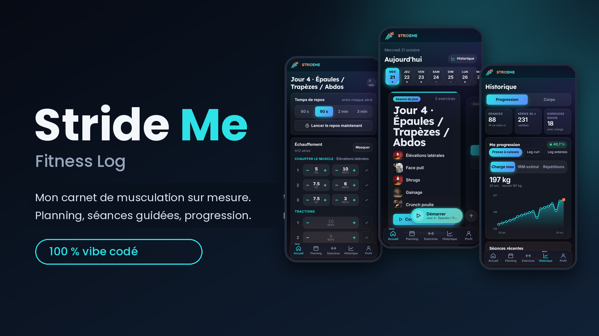
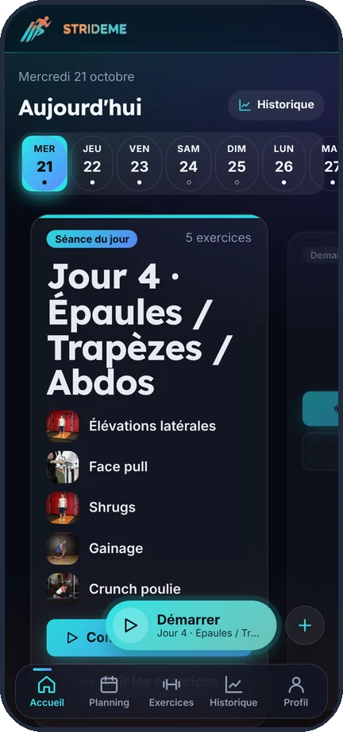
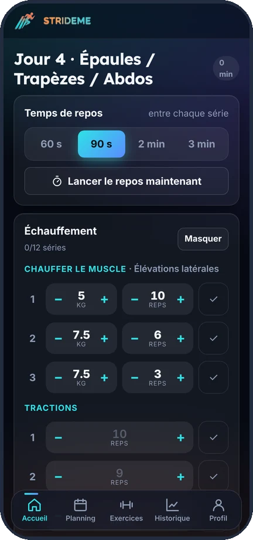
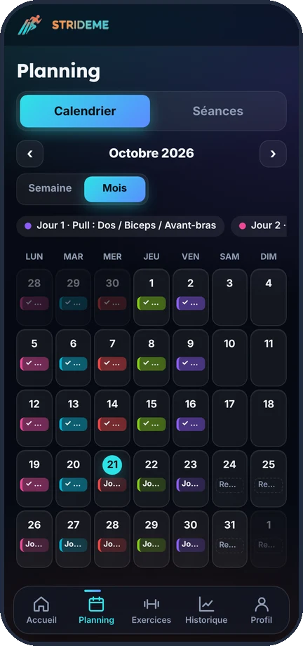
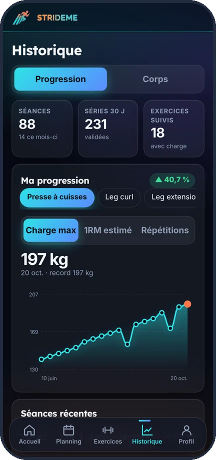
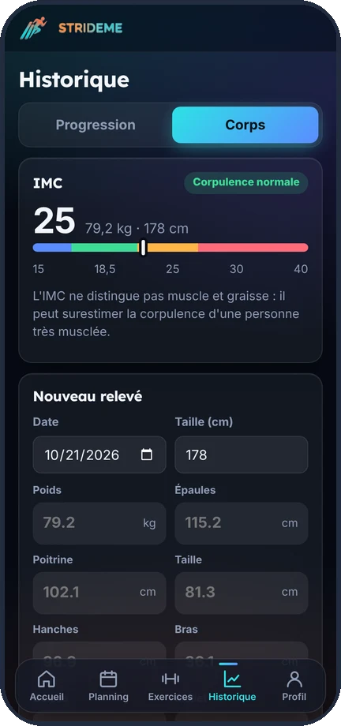
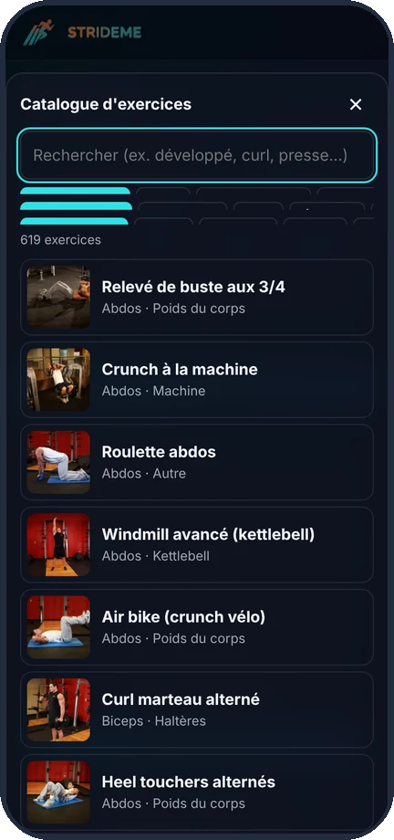
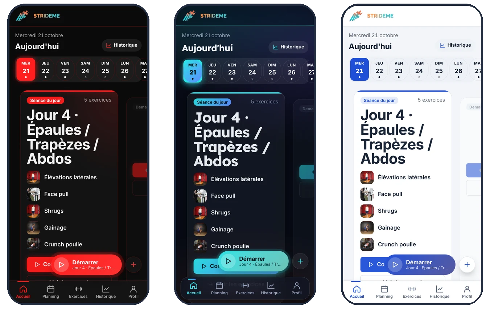

<p align="center">
  
</p>

<p align="center">
  <a href="https://awabeleperdu.github.io/Stride-Me/"></a>
  
  
  
  
</p>

# Stride Me – Fitness Log

Étudiant en informatique (BTS CIEL), je n'ai trouvé aucune appli de musculation qui me plaisait : des pubs partout, des abonnements pour débloquer le minimum, et surtout aucune vraie modularité. Impossible d'avoir mon propre échauffement, de décaler une séance sans tout casser ou de construire mes séances comme je veux. Alors j'ai créé une application sur mesure, pour moi. Elle est en ligne ici : **https://awabeleperdu.github.io/Stride-Me/**

## 🎬 Présentation en 30 secondes

<!-- VIDEO : glisse-dépose stride-me-readme-muet-1080p.mp4 ICI (sur la ligne vide juste en dessous), puis supprime ce commentaire -->

## 🧪 Essayer la démo

Pas besoin de créer un compte : un compte de démonstration est rempli avec **5 mois de suivi** (une centaine de séances, échauffements, courbes de progression, mesures du corps) pour voir l'appli telle qu'elle est après des mois d'utilisation.

| | |
|---|---|
| **Site** | https://awabeleperdu.github.io/Stride-Me/ |
| **E-mail** | `demo@stride-me.app` |
| **Mot de passe** | `METS_ICI_LE_MOT_DE_PASSE` |

> Compte en **lecture seule** : tu peux tout consulter, mais rien ne peut y être ajouté ni modifié.

## Un projet vibe codé

Ce projet est **entièrement vibe codé** : je n'ai pas écrit le code à la main, tout est parti de prompts. Je décide de ce que l'appli doit faire, je teste sur mon téléphone, je dis ce qui ne va pas, et on recommence.

Ça m'a appris beaucoup de choses :

- **Prompter correctement.** Au début mes demandes étaient floues et les résultats aussi. J'ai appris à décrire précisément ce que je veux, à donner le contexte, à demander des modifications ciblées plutôt que de tout refaire, et à décrire un bug pour qu'il soit corrigeable.
- **Mener un projet complexe de A à Z.** Une quinzaine d'écrans, des règles de planning, des comptes, un espace admin, sans casser ce qui marchait déjà.
- **Héberger un site.** Mettre les fichiers sur GitHub, activer GitHub Pages, comprendre pourquoi un seul fichier mal remplacé peut casser tout le site (ça m'est arrivé).
- **Gérer une base de données avec Firebase.** Comptes, collections Firestore, règles de sécurité pour que chacun ne voie que ses données, différence entre utilisateur et administrateur.
- **La structure d'un projet web.** Où vont le HTML, le CSS, le JavaScript, les images, le manifeste pour installer l'appli sur le téléphone, et pourquoi tout est découpé comme ça.

J'ai aussi appris que l'IA se trompe : il faut tester, vérifier, et chercher d'où vient le problème (un menu admin qui n'apparaissait pas, une icône avec des bords blancs, un cache qui gardait l'ancienne version du site).

## Ce que fait l'appli

<table>
<tr><td width="55%" valign="middle">

### 📅 Le planning

Je règle mon cycle de séances (Pull, Push, Legs…) et l'appli me dit quoi faire chaque jour. Si je décale une séance parce que je n'ai pas pu y aller, je la mets où je veux et **tout le reste du calendrier se réorganise tout seul**. Elle ajoute des jours de repos quand il faut et me demande confirmation si la même séance tombe deux jours de suite.

</td><td width="45%" align="center"></td></tr>
<tr><td width="45%" align="center"></td><td width="55%" valign="middle">

### 🏋️ La séance

Je valide mes séries une par une, avec la charge et les répétitions. La dernière fois que j'ai fait l'exercice est déjà affichée, donc je sais quoi battre. Un minuteur de repos sonne entre les séries, et une carte d'**échauffement** me fait monter en charge sur le premier exercice, puis enchaîner **mon échauffement perso** (tractions, pompes, dips en 3 séries), modifiable dans le profil.

</td></tr>
<tr><td width="55%" valign="middle">

### 🗓️ Le calendrier

Vue semaine ou vue mois : ce qui est fait, ce qui est prévu, les jours de repos. Je peux déplacer une séance d'un jour à l'autre.

</td><td width="45%" align="center"></td></tr>
<tr><td width="45%" align="center"></td><td width="55%" valign="middle">

### 📈 La progression

Des courbes par exercice (charge max, 1RM estimé, répétitions), l'historique de toutes mes séances et l'évolution en pourcentage. Je vois tout de suite si je progresse ou si je stagne. Export CSV possible.

</td></tr>
<tr><td width="55%" valign="middle">

### ⚖️ Le suivi du corps

Poids, IMC et mensurations (épaules, poitrine, taille, bras, cuisse, mollet) avec des courbes pour voir l'évolution au fil des semaines.

</td><td width="45%" align="center"></td></tr>
<tr><td width="45%" align="center"></td><td width="55%" valign="middle">

### 📚 Les exercices

Un catalogue de **619 exercices**, traduits en français, avec images. Je filtre par zone du corps, je crée mes propres exercices avec photo, ou je laisse l'appli composer une séance à partir de zones musculaires.

</td></tr>
</table>

## 🔗 Les codes de séance

Chaque séance peut être partagée avec un code : un ami le tape et la récupère directement dans son planning. J'ai aussi mis deux programmes complets de 5 jours déjà prêts, avec les codes `2008` et `2000`. Je peux aussi tout supprimer d'un coup pour repartir de zéro.

## 🎨 Personnalisation

5 thèmes (Pro, Aurora, Clair, Dark, Salle), plusieurs polices dont deux pensées pour l'accessibilité, taille du texte et espacement réglables. L'appli s'installe sur l'écran d'accueil du téléphone comme une vraie appli.

<p align="center"></p>

## 🔐 Comptes et administration

Connexion par e-mail, données privées pour chaque utilisateur, appareils connectés visibles dans le profil, et un espace administrateur protégé par un code pour voir les comptes et bloquer quelqu'un si besoin. Depuis cet espace je peux aussi publier des **annonces** : un message, un sondage ou une question, envoyés à tout le monde ou à une seule personne, pour récupérer des retours et améliorer l'appli.

## Technique

Du JavaScript natif, sans framework ni outil de build, hébergé gratuitement sur GitHub Pages. Les comptes et les données passent par Firebase (Authentication et Firestore).

```
index.html              page d'entrée
manifest.webmanifest    installation sur l'écran d'accueil
sw.js                   petit service worker pour l'installation Android
css/                    styles et thèmes
js/                     un fichier par écran (main.js démarre tout)
assets/                 logos, icônes et catalogue d'exercices
```

## Crédits

Le catalogue d'exercices vient de [free-exercise-db](https://github.com/yuhonas/free-exercise-db) (domaine public), que j'ai fait traduire en français.
